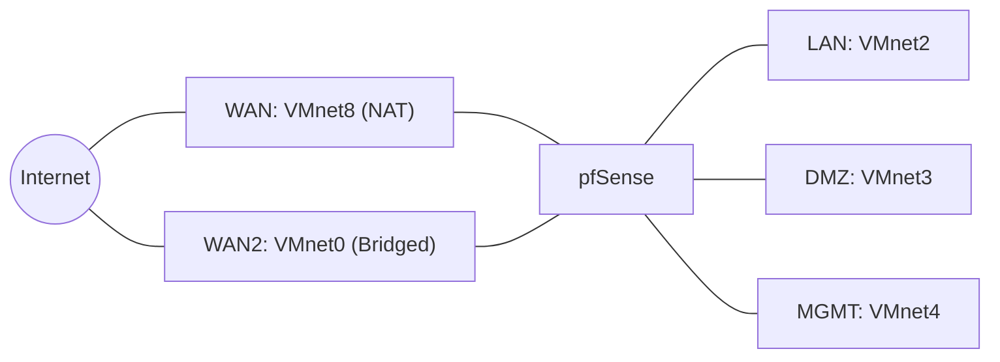

# Netzwerk-Topologie

Dieses Dokument beschreibt die Umgebung des Projekts: Software, Netzwerke und virtuelle Maschinen.

## Umgebung

| Komponente | Wert |
|---|---|
| Firewall | pfSense 2.9.0-RELEASE (amd64) |
| Host-System | Ubuntu Desktop |
| Virtualisierung | VMware Workstation |
| Server-VMs | Ubuntu Server 26.04 |
| Oberfläche | pfSense Web GUI (Englisch) |

## Topologie

## Netzwerke

| Netzwerk | VMware-Netz | Subnetz | pfSense-IP |
|---|---|---|---|
| WAN | VMnet8 (NAT) | per DHCP | per DHCP |
| WAN2 | VMnet0 (Bridged) | per DHCP | per DHCP |
| LAN | VMnet2 (Host-only) | 10.10.10.0/24 | 10.10.10.2 |
| DMZ | VMnet3 (Host-only) | 10.10.20.0/24 | 10.10.20.2 |
| MGMT | VMnet4 (Host-only) | 10.10.30.0/24 | 10.10.30.2 |
| VLAN 10 | über LAN-Port | 10.10.110.0/24 | 10.10.110.2 |
| VLAN 20 | über LAN-Port | 10.10.120.0/24 | 10.10.120.2 |
| OpenVPN Tunnel | virtuell | 10.10.100.0/24 | – |
| WireGuard Tunnel | virtuell | 10.10.101.0/24 | 10.10.101.1 |

## Virtuelle Maschinen

| VM | Aufgabe | IP-Adresse |
|---|---|---|
| `pfsense` | Firewall | siehe Netzwerke |
| `ubuntu-server` | Test-Client im LAN | 10.10.10.10 |
| `dmz-server` | Webserver in der DMZ | 10.10.20.10 |
| `server-vlan10` | Test-Server in VLAN 10 | per DHCP |
| `client-vlan20` | Test-Client in VLAN 20 | per DHCP |
| `jump-server` | Jump Server im Management-Netz | 10.10.30.10 |